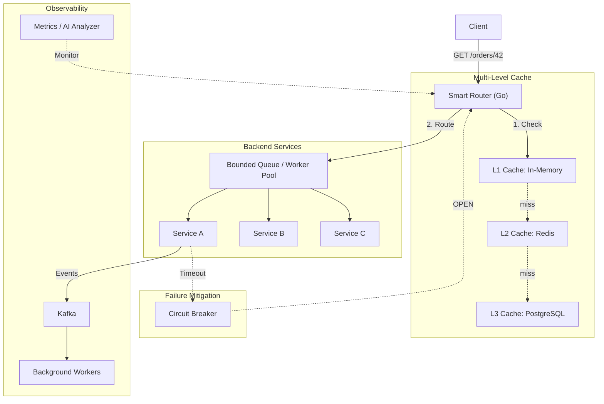

# 🌌 Adaptive Distributed Request Fabric for Low-Latency Computing

A local-first distributed systems platform that intelligently routes client requests across multiple service nodes. It demonstrates how a modern backend infrastructure maintains **low latency and high throughput** even when services become busy or unavailable by leveraging multi-level caching, concurrent worker pools, backpressure, circuit breaking, and a Rust-powered performance core.

## 🧠 Problem Statement
In high-throughput microservice architectures, naive request routing leads to cascading failures, cache stampedes, and memory exhaustion. This project solves these challenges by implementing an adaptive "request fabric" that safely limits load (backpressure), isolates failing nodes (circuit breaking), and accelerates responses through a 3-tier cache hierarchy (Memory -> Redis -> Postgres).

## 🏗️ Architecture



## ⚡ Core Features

1. **Smart Request Routing**: Dynamically distributes traffic across healthy service nodes.
2. **Bounded Concurrency & Backpressure**: Uses Go channels and bounded worker pools to ensure the system safely sheds load (HTTP 503) rather than crashing under heavy traffic.
3. **Multi-Level Caching (L1/L2/L3)**:
   - **L1**: Go `sync.Map` (in-process, fastest)
   - **L2**: Shared Redis cluster
   - **L3**: Persistent PostgreSQL datastore
4. **Resiliency Patterns**:
   - **Exponential Backoff Retries**: Automatically retries transient failures.
   - **State-Machine Circuit Breakers**: Isolates repeatedly failing nodes (CLOSED -> OPEN -> HALF-OPEN).
5. **Rust Performance Engine**: A highly-optimized Rust crate for calculating adaptive routing paths, demonstrating interoperability between Go orchestrators and Rust FFI components for zero-cost abstractions.
6. **Kafka Event Processing**: Decouples heavy background work from the synchronous request path.

## 🛠️ Technology Stack
- **Go**: Core API gateway, worker pools, orchestration, circuit breakers.
- **Rust**: Performance-critical routing policy engine.
- **Redis**: Fast, shared L2 cache.
- **PostgreSQL**: Persistent L3 cache / database.
- **Docker**: Full multi-container local simulation.

## 🚀 Getting Started

No paid cloud dependencies required. Run the entire distributed system locally via Docker:

```bash
# 1. Bring up the network (Router, 3x Services, Redis, Postgres, Kafka)
docker-compose up --build -d

# 2. Fire a request
curl http://localhost:8000/orders/42

# 3. Watch the multi-level cache in action!
# Attempt 1: "cache": "miss"
# Attempt 2: "cache": "L1"
```

## 📂 Project Structure
- `cmd/router`: The Go API gateway and traffic orchestrator.
- `cmd/service`: The simulated backend service nodes.
- `internal/`: Core distributed systems logic (`worker`, `cache`, `circuitbreaker`, `retry`).
- `rust/routing-engine`: The Rust performance core.
- `docker-compose.yml`: Local infrastructure deployment.
